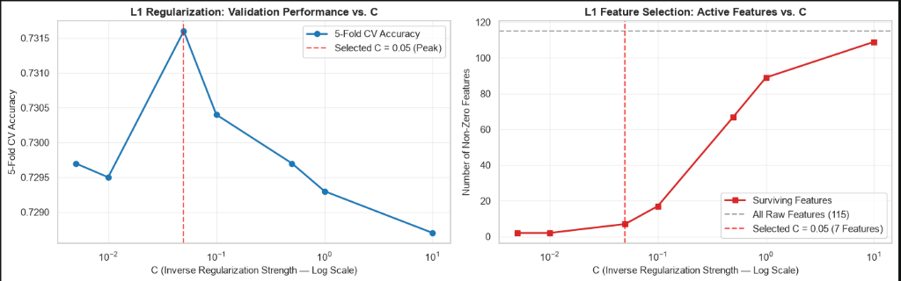
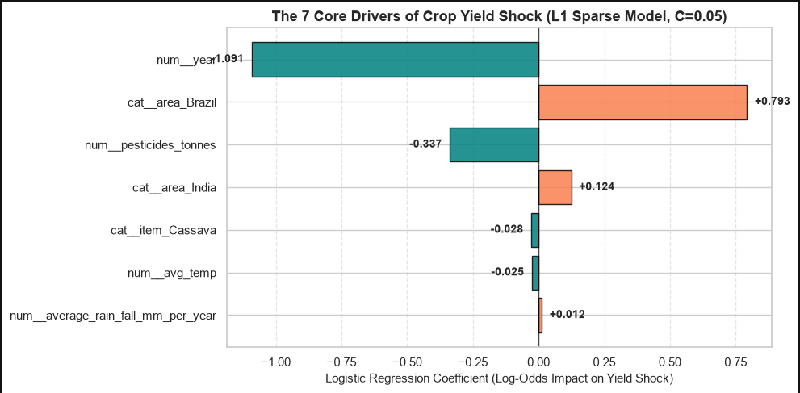
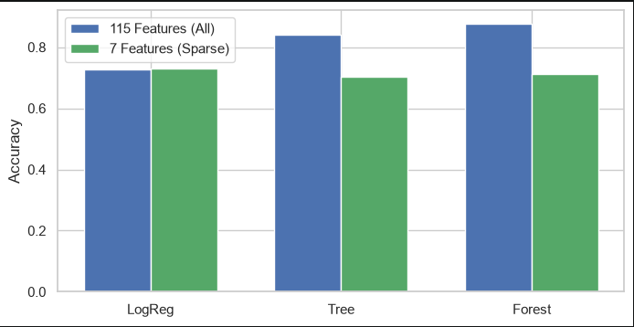
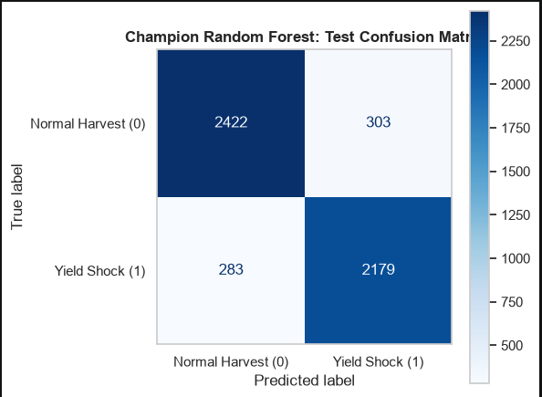

# 🌱 Global Crop Yield Shock Prediction: An End-to-End ML Benchmark

A machine learning pipeline investigating agricultural yield resilience, climate impact, and feature sparsity across 101 countries and 10 major global crops using historical UN FAO and climate datasets (25,932 records).

---

## 📌 Executive Summary

Predicting catastrophic harvest losses ("yield shocks") is critical for proactive disaster relief, food security planning, and agricultural supply chain resilience. 

This project explores:
1. **Feature Sparsity via L1 Regularization (Lasso Path)**: Sweeping inverse regularization penalty $C \in [0.005, 10.0]$ to identify the minimal set of global climate and technological drivers.
2. **Model Architecture Trade-offs**: Comparing linear models against non-linear tree ensembles (Decision Tree, Random Forest) across both high-dimensional and ultra-sparse feature spaces.
3. **Dual Deployment Paradigms**: Developing both a **Heavyweight Production Champion (88.7% Accuracy)** and an **Ultra-Sparse Edge Model (73.5% Accuracy with 94% fewer inputs)**.

---

## 🎯 Target Formulation: The FAO Group Median

To avoid global crop mass distortion (e.g., potatoes weighing significantly more per hectare than wheat or rice), the target is formulated as a **group-relative binary indicator**:

$$\text{yield\_shock} = \begin{cases} 1, & \text{if } \text{Yield} < \text{Median}(\text{Country, Crop}) \\ 0, & \text{otherwise} \end{cases}$$

- **Class Balance**: 52.5% Normal Harvest (`0`) vs. 47.5% Yield Shock (`1`).

---

## 🔬 Key Scientific Findings

### 1. The L1 Regularization Sweet Spot ($C = 0.05$)
Under aggressive L1 penalty, the model pruned **108 of the 115 features** (a 94% reduction) while **increasing** cross-validation accuracy from 72.86% to 73.16%:

<p align="center">
  
</p>

```
Total Features Evaluated: 115
Features Retained:          7  (4 Numerical Climate/Tech + 3 Geographic/Crop Categories)
Features Discarded:       108
```

---

### 2. The 7 Core Drivers of Yield Shock

<p align="center">
  
</p>

| Feature | Learned Coefficient | Odds Ratio ($e^w$) | Agronomic / Statistical Meaning |
| :--- | :---: | :---: | :--- |
| **`num__year`** | **$-1.091$** | **$0.34\times$** | **Technological Progress**: Strongest protective factor. Modern genetics, mechanization, and ag-tech systematically reduce shock probability over time. |
| **`cat__area_Brazil`** | **$+0.793$** | **$2.21\times$** | **High Climate Sensitivity**: Exposure to Amazonian/Cerrado rainfall shifts and El Niño cycles; distinct high-volume pesticide regime. |
| **`num__pesticides_tonnes`** | **$-0.337$** | **$0.71\times$** | **Input Protection**: Consistent pest management significantly reduces catastrophic crop failure. |
| **`cat__area_India`** | **$+0.124$** | **$1.13\times$** | **Monsoon Vulnerability**: Sensitivity to summer monsoon onset timing and distribution. |
| **`cat__item_Cassava`** | **$-0.028$** | **$0.97\times$** | **"Famine-Reserve" Crop**: Woody root shrub biologically resilient to prolonged drought, unlike annual cereals. |
| **`num__avg_temp`** | **$-0.025$** | **$0.98\times$** | Macro-scale climatic baseline. |
| **`num__average_rain_fall_mm_per_year`** | **$+0.012$** | **$1.01\times$** | Macro-scale precipitation baseline. |

---

## 📊 Performance Benchmark: 115 Features vs. 7 Features

When stripped of 108 categories and tested on only the 7 core features:
- **Logistic Regression** maintained stability (**$73.06\%$** vs **$72.86\%$**). Linear models benefit from the elimination of noisy, collinear categories.
- **Decision Trees & Random Forests** dropped from **$87.65\%$** down to **$71.09\%$**. Tree ensembles rely on granular country-crop combinations to construct deep interaction splits.

<p align="center">
  
</p>

---

## 🏆 Final Test Set Results (Unseen Holdout: 5,187 samples)

<p align="center">
  
</p>

| Model Architecture | Features Used | Test Accuracy | Precision | Recall | F1-Score | Use Case |
| :--- | :---: | :---: | :---: | :---: | :---: | :--- |
| **Champion Random Forest** | **115** | **88.70%** | **87.79%** | **88.51%** | **88.15%** | **Cloud APIs & Institutional Early Warning Systems** |
| **Sparse Logistic Regression** | **7** | **73.49%** | **71.74%** | **72.79%** | **72.26%** | **Edge Devices / Low-Bandwidth IoT Sensors** |

---

## 📁 Repository Structure

```
yield_project/
├── data/
│   └── df_yield_merged.csv       # Merged FAO + Climate dataset
├── images/                       # Visualizations for documentation
│   ├── l1_regularization_path.png
│   ├── core_drivers_coefficients.png
│   ├── feature_count_comparison.png
│   └── champion_confusion_matrix.png
├── models/
│   ├── preprocessor.joblib       # Fitted ColumnTransformer (StandardScaler + OneHotEncoder)
│   ├── champion_yield_model.joblib # Serialized 88.7% Champion Ensemble (git-ignored)
│   └── final_model.joblib        # Baseline L1 model
├── yield_model.ipynb             # Complete interactive Jupyter Notebook
└── README.md                     # Project documentation
```

---

## 🚀 How to Reproduce

1. **Clone the repository**:
   ```bash
   git clone https://github.com/sammanbhetwal/machine-learning.git
   cd "machine Learning/yield_project"
   ```

2. **Create a virtual environment & install requirements**:
   ```bash
   python3 -m venv .venv
   source .venv/bin/activate
   pip install numpy pandas scikit-learn matplotlib seaborn joblib ipykernel
   ```

3. **Run the Notebook**:
   Open and run all cells in `yield_model.ipynb`.

---
**Author:** Samman Bhetwal  
**Contact:** sammanbhetwal2025@gmail.com  
